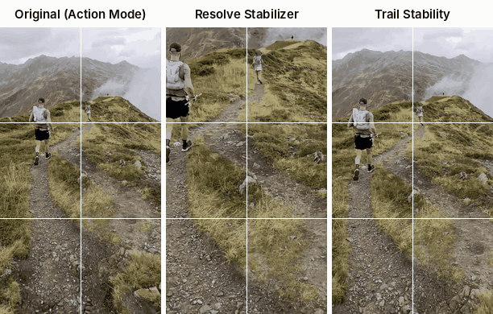

# Trail Stability

An OpenFX plugin for DaVinci Resolve that stabilizes running footage from the iPhone
(Action Mode). It removes the step-rhythm sway that Action Mode leaves behind and keeps
the camera moves you meant: head turns and looking around stay, the wobble goes.



*3 seconds of a trail run (Clip 3), same frames: the white lines are fixed, so
any movement against them is shake. Resolve's stabilizer zooms in about 2× and tilts the
picture; Trail Stability keeps the view and calms it.*

> Built for my own trail-run videos: iPhone 14 Pro, Action Mode, DaVinci Resolve Studio
> 21.1 on an Apple Silicon Mac. It may work elsewhere, but I don't test or support other
> setups.

## Why another stabilizer?

Action Mode already removes the fast vibration very well. What remains is a slow sway at
the rhythm of your steps (0.5–2 Hz, 1–2° per step), and that is exactly where 2D
stabilizers like Resolve's get it wrong:

- **The horizon tilts.** When you run, the camera points down at the trail (about 15°).
  If you then turn your head, the picture really does rotate in 2D. A 2D stabilizer
  (Similarity/Perspective) takes that for roll and "corrects" it, so the horizon tips
  over, on weak tracks by tens of degrees.
- **The ground pulls the picture forward.** The trail right in front of you streams
  downward. A perspective model fits itself to the ground plane and adds pitching and
  keystone distortion that never happened.
- **Heavy zoom.** To hide all that, it crops a lot (about 2× in the clips below), which
  also magnifies every bit of remaining shake.

Trail Stability models the camera as what it is: a camera that **rotates in 3D** with a
known field of view. It estimates the true rotation for every frame, finds gravity in the
footage, and then computes the calmest camera path that still fits inside a fixed crop
(default 1.25×). Slow, large moves are part of that path, so head turns are kept.

## Results

Measured on three of my trail-run clips by re-tracking the rendered output (not the
plugin's own numbers): image motion in the middle third of the frame, everything faster
than about 1 Hz, in pixels per frame at 1080 px width, exactly as seen on screen.


| Clip | Original | Resolve Stabilizer | Trail Stability |
|---|---|---|---|
| Clip 1 (14.7 s) | 3.1 | 4.0 (+29 %) | **1.7 (−44 %)** |
| Clip 2 (18.2 s) | 2.4 | 2.6 (+8 %) | **1.4 (−43 %)** |
| Clip 3 (23.6 s) | 3.9 | 7.4 (+88 %) | **2.3 (−42 %)** |

Resolve: built-in Stabilizer, Perspective mode, Crop Ratio 0.500, Smooth 0.313,
Strength 0.115. Part of its higher number comes from its
stronger zoom (about 2× against 1.25×), which is what you see in the final video. Other
Resolve settings may do better; these are the ones I used.

What a pure rotation model cannot remove: the up-and-down of your body while running
(translation). It shows mostly on very close ground and is the main part of what remains.

## Requirements

- Mac with Apple Silicon (tested: MacBook Pro M1)
- DaVinci Resolve Studio (tested: 21.1.2)
- Xcode Command Line Tools and CMake to build:
  `xcode-select --install`, `brew install cmake`

## Build and install

```bash
git clone https://github.com/jens-krause/trail-stability.git
cd trail-stability
./update.sh
```

`update.sh` builds the plugin (OpenFX and OSQP are downloaded by CMake), runs the self
test and only then installs `TrailStab.ofx.bundle` to `/Library/OFX/Plugins` (asks for
your password). It also clears Resolve's plugin cache. Then restart Resolve.
After an Xcode update use `./update.sh --sauber` for a clean build.

The plugin appears under **Effects → OpenFX → Filter → Trail Stability**.

## Usage

1. Put the clip on a timeline and drop **Trail Stability** on it (Edit page).
2. Optional: move the playhead to the start of the part you use and press
   **Set Playhead as Start**, then the same for the end. Saves time on long clips;
   1 s margin is added on both sides. **Set Whole Clip** resets it.
3. Set **Playback Resolution** to Half or Full (Playback menu). The analysis works on
   what Resolve delivers and refuses to run on a smaller picture.
4. Press **Run Analysis**. It takes about 30 s per 1000 frames on an M1, and Resolve does
   not respond until it is finished. The result is stored in the project, no extra files.
5. Adjust the look. These change instantly, without a new analysis:

| Control | Default | What it does |
|---|---|---|
| Smoothing Window (s) | 1.7 | Motion shorter than this is smoothed out, longer moves (head turns) are kept. Larger = calmer, needs more zoom. |
| Zoom (Crop Budget) | 1.25 | How far the picture is zoomed in. The camera path always stays inside this frame. |
| Level Horizon | on | Keeps the virtual camera level, using gravity estimated from the footage. |

The **Status** line shows the analysed range, whether the camera path was solved, the
largest correction and how long the analysis took. Run the analysis again when you change
the clip's speed or replace the clip.

**Developer** (collapsed): *Analysis Width* (360–720 px, default 540: smaller is faster,
less precise), *Precise Solver* (tighter tolerance, about 3× slower path calculation; for
when the status shows "OK (approx.)"), *Delete Analysis*.

### Limits

- Tuned for the iPhone 14 Pro Action Mode field of view (focal length ≈ 1.02 × picture
  width, `focalNorm` in `core/analysis.h`). Other cameras need that value changed.
- Rotation only: running bounce and parallax of very near objects stay.
- One camera path per effect, so the controls are not keyframeable.
- Resolve gives a plugin the whole source clip, not the cut on the timeline; use the
  start/end buttons to limit the analysis.
- Resolve does not respond while the analysis runs and it cannot be cancelled; use the
  start/end buttons to keep long clips short.

### Log

`~/Library/Logs/TrailStab.log` lists analysis runs and errors. Above 1 MB it is renamed
to `TrailStab.old.log` (replacing the previous one), so both together stay below about 2 MB. For detailed timing:
`touch ~/Library/Logs/TrailStab.debug` and restart Resolve; delete the file to turn it off.

## How it works

1. **Tracking**: corner features on a 540 px grey image, pyramidal Lucas-Kanade with a
   forward-backward check.
2. **Rotation**: per frame a robust 3D rotation (2-point RANSAC + reweighting); chains
   over 10 frames correct the slow drift.
3. **Gravity**: a Kalman filter run forward and backward estimates the "down" direction,
   so the horizon can be levelled although the camera often looks down.
4. **Camera path**: a quadratic program (OSQP) finds the smoothest rotation path that
   keeps every corner of the zoomed view inside the original picture.
5. **Render**: one homography per frame, bicubic, on Resolve's Metal queue (CPU fallback).

Development notes and measurements (German): [docs/DESIGN.md](docs/DESIGN.md).

## Repository

```
core/            analysis, path solver, warp (plain C++, no OpenCV)
ofx/             OpenFX plugin and Metal renderer
tools/           self test, offline analysis (analyze_cli), Metal kernel test
tools/measure/   scripts for the measurements and README media
docs/            design notes, README media
update.sh        build, test, install
```

## License

MIT, see [LICENSE](LICENSE). Downloaded at build time and linked in:
[OpenFX](https://github.com/AcademySoftwareFoundation/openfx) (BSD-3-Clause) and
[OSQP](https://github.com/osqp/osqp) (Apache-2.0).
