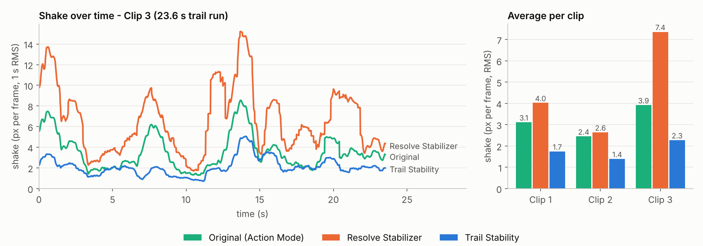

# Trail Stability

My partner records her trail runs with her iPhone in Action Mode. I usually edit the videos
afterwards in DaVinci Resolve, and I regularly run into the limits of its stabilizer.

To remove most of the oscillation of running from these videos I built **Trail Stability**,
an OpenFX plugin for DaVinci Resolve Studio. It takes out the sway in the rhythm of the steps
and keeps the camera moves that are meant: head turns and looking around stay, the wobble goes.

> Built for my own setup: iPhone 14 Pro in Action Mode, DaVinci Resolve Studio 21.1 on an
> Apple Silicon Mac. It may work elsewhere, but I don't test or support other setups.
>
> A project page with the same story is on my site:
> [jens-krause.github.io/tools/trail-stability](https://jens-krause.github.io/tools/trail-stability/trail_stability.html)

## Does it need another stabilizer?

Action Mode already removes the high-frequency shake (vibration, impacts). What remains is a
slow sway in the rhythm of the steps: at a cadence of 120 that is 1 Hz, at 1–2° per step.
2D stabilizers like Resolve's read that wrong in three ways:

1. **The horizon tilts.** If your eyes are on the horizon, it stays level when you turn your
   head. When trail running, your head is pointed at the ground, so a head turn tilts the
   horizon (especially with wide-angle lenses). Resolve's models interpret that as roll and
   "correct" it.
2. **The ground pulls the picture forward.** Resolve's Perspective model reads the ground
   rushing past as camera motion and tries to compensate. Distant mountains hardly move, so
   it adds pitch and keystone distortion that never happened, and the picture rocks like a
   seesaw.
3. **Heavy zoom.** When I stabilize a trail-run clip with Resolve, it zooms in by about 2×.
   That cuts away a lot of the picture and also magnifies the remaining shake and the noise.

Trail Stability therefore assumes a 3D camera that **only rotates** and whose field of view is
known. That fills a gap in Resolve: its built-in stabilizer offers three modes.

- **Translation** stabilizes 2D shift only.
- **Similarity** stabilizes 2D shift and rotation.
- **Perspective** stabilizes 2D shift, rotation and tilt.

**A mode for pure rotation stabilization is missing from this list.**

The plugin estimates the true rotation of every frame, finds gravity and computes the calmest
camera path that still fits inside a fixed crop (default 1.25×). Large, slow moves are part of
that path and stay, so the result is a trail run clip that still feels authentic.


*From left to right: Original (restless sway), Resolve Stabilizer (zooms a lot, picture
tilts), Trail Stability (calmer and authentic). 3 seconds of Clip 3, same frames. The white
lines are fixed and make unsteady motion easier to see. Resolve's stabilizer zooms in about
2× and tilts the picture; Trail Stability keeps the crop and calms it.*

## How it works

1. **Tracking**: corner features on a 540 px wide grey image, pyramidal Lucas-Kanade with a
   forward-backward check.
2. **Rotation**: a robust 3D rotation per frame (2-point RANSAC with reweighting). Chains over
   10 frames correct slow drift.
3. **Gravity**: a Kalman filter, run forward and backward, estimates the direction of "down".
   That is how the horizon can be levelled although the camera looks at the ground.
4. **Camera path**: a quadratic program (OSQP) finds the smoothest rotation path that keeps
   every corner of the zoomed view inside the original picture.
5. **Render**: one homography per frame, bicubic, on Resolve's Metal queue (CPU fallback).

The analysis result is stored in the Resolve project; the camera path is recalculated from it
whenever you change a control, so the controls react instantly.

Development notes and measurements (German): [docs/DESIGN.md](docs/DESIGN.md).

## Numbers beat words

So that I'm not just claiming it is better, I measured the "unrest" in the picture on three
stabilized trail-run clips by re-tracking the rendered result. These are not the plugin's own
numbers. The measure is the average image motion in the central third of the frame,
everything faster than about 1 Hz, in pixels per frame at 1080 px width, exactly as seen on
screen.



Resolve: built-in Stabilizer, Perspective mode, Crop Ratio 0.500, Smooth 0.313,
Strength 0.115. Part of Resolve's higher number comes from its stronger zoom (about 2×
against 1.25×). With other Resolve settings it can score better, but in my experience there
is then hardly any stabilization left.

What pure rotation cannot remove is the up and down of the body while running. It shows
mostly on very close ground and is the biggest part of what remains. I find that authentic
for trail runs.

## Limits

- Tuned for the field of view of the iPhone 14 Pro in Action Mode (focal length ≈ 1.02 × picture
  width, `focalNorm` in `core/analysis.h`). Other cameras need that value changed.
- One camera path per effect, so the controls cannot be keyframed.
- Resolve gives a plugin the whole source clip, not the cut on the timeline. For short parts of
  long clips, limit the analysis with the start/end buttons.
- Resolve does not respond while the analysis runs, and it cannot be cancelled.

## Requirements

- Mac with Apple Silicon (tested: MacBook Pro M1)
- DaVinci Resolve Studio (tested: 21.1.2)
- Xcode Command Line Tools and CMake to build:
  `xcode-select --install`, `brew install cmake`
- Optional, only for the measurement scripts in `tools/measure/`: `ffmpeg`, Python with
  NumPy, OpenCV, SciPy, Matplotlib and Pillow

## Build and install

```bash
git clone https://github.com/jens-krause/trail-stability.git
cd trail-stability
./update.sh
```

`update.sh` builds the plugin (OpenFX and OSQP are downloaded by CMake), runs the self test and
only then installs `TrailStab.ofx.bundle` to `/Library/OFX/Plugins` (asks for your password).
It also clears Resolve's plugin cache. Then restart Resolve.
After an Xcode update use `./update.sh --sauber` for a clean build.

The plugin appears under **Effects → OpenFX → Filter → Trail Stability**.

## Usage

1. Put the clip on a timeline and drop **Trail Stability** on it (Edit page).
2. Optional: move the playhead to the start of the part you use and press
   **Set Playhead as Start**, then the same for the end. Saves time on long clips;
   1 s margin is added on both sides. **Set Whole Clip** resets it.
3. Set **Playback Resolution** to Half or Full (Playback menu). The analysis works on
   what Resolve delivers and refuses to run on a smaller picture.
4. Press **Run Analysis**. It takes about 30 s per 1000 frames on an M1, and Resolve does
   not respond until it is finished. The result is stored in the project, no extra files.
5. Adjust the look. These change instantly, without a new analysis:

| Control | Default | What it does |
|---|---|---|
| Smoothing Window (s) | 1.7 | Motion shorter than this is smoothed out, longer moves (head turns) are kept. Larger = calmer, needs more zoom. |
| Zoom (Crop Budget) | 1.25 | How far the picture is zoomed in. The camera path always stays inside this frame. |
| Level Horizon | on | Keeps the virtual camera level, using gravity estimated from the footage. |

The **Status** line shows the analysed range, whether the camera path was solved, the largest
correction and how long the analysis took. Run the analysis again when you change the clip's
speed or replace the clip; until then the picture is passed through unstabilized and the
status says so.

**Developer** (collapsed): *Analysis Width* (360–720 px, default 540: smaller is faster, less
precise), *Precise Solver* (tighter tolerance, about 3× slower path calculation; for when the
status shows "OK (approx.)"), *Delete Analysis*.

### Log

`~/Library/Logs/TrailStab.log` lists analysis runs and errors. Above 1 MB it is renamed to
`TrailStab.old.log` (replacing the previous one), so both together stay below about 2 MB.
For detailed timing: `touch ~/Library/Logs/TrailStab.debug` and restart Resolve; delete the
file to turn it off.

## Repository

```
core/            analysis, path solver, warp (plain C++, no OpenCV)
ofx/             OpenFX plugin and Metal renderer
tools/           self test, offline analysis (analyze_cli), Metal kernel test
tools/measure/   scripts for the measurements and README media
docs/            design notes, README media
update.sh        build, test, install
```

## License

MIT, see [LICENSE](LICENSE). Downloaded at build time and linked in:
[OpenFX](https://github.com/AcademySoftwareFoundation/openfx) (BSD-3-Clause) and
[OSQP](https://github.com/osqp/osqp) (Apache-2.0).
